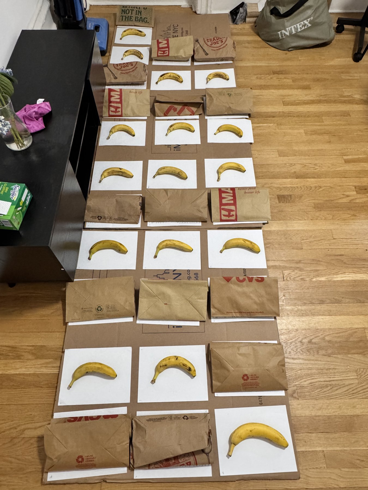
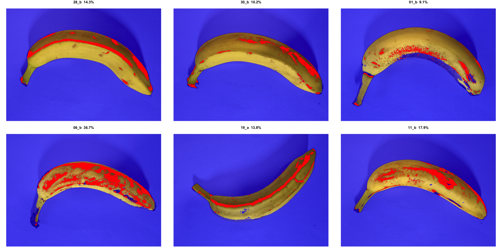

```{r setup, include=FALSE}
knitr::opts_chunk$set(echo = FALSE, message = FALSE, warning = FALSE,
                      fig.align = "center", fig.width = 6, fig.height = 4)
library(randomizr)
library(ri2)
library(estimatr)
library(dplyr)
library(broom)
library(ggplot2)
library(knitr)

rm(list = ls())
PRIMARY_DAY <- 3

theme_set(theme_bw(base_size = 11) +
  theme(plot.title = element_text(hjust = 0.5),
        plot.subtitle = element_text(hjust = 0.5, size = 9)))
fmt   <- function(x, k = 1) formatC(x, format = "f", digits = k)
fmt_p <- function(p) if (p < 0.001) "< 0.001" else paste("=", formatC(p, format = "f", digits = 3))
```

```{r data}
# Assignment (written by R/02_randomize.R) and Day-0 percent brown (frozen R/03_measure_photos.R)
a <- read.csv("data/assignment.csv")
a$brown0 <- a$brown0_v1

# Day-3 outcomes from the frozen measurement script
photos <- read.csv("data/brown_from_photos_v1.csv")
day3   <- photos[photos$day == PRIMARY_DAY, c("id", "brown_pct", "brown_index")]

SIMULATED <- nrow(day3) == 0
if (SIMULATED) {
  # Placeholder until the Day-3 photos are processed: constant 10 pp effect, bounded 0-100
  set.seed(1)
  pair_shift <- rnorm(16, 0, 10)[a$pair]
  y0 <- a$brown0 + 15 + pair_shift + rnorm(nrow(a), 0, 8)
  day3 <- data.frame(id = a$id, brown_pct = pmin(100, pmax(0, y0 + 10 * a$Z)))
  day3$brown_index <- day3$brown_pct / 2
}
d <- merge(a, day3, by = "id")
d$Y <- d$brown_pct

# Blind 1-7 ripeness grades of the Day-3 photos (secondary outcome), if available
if (file.exists("data/blind_grades.csv")) d <- merge(d, read.csv("data/blind_grades.csv"), by = "id")

d$condition <- factor(ifelse(d$Z == 1, "Paper bag", "Open air"), levels = c("Open air", "Paper bag"))
d$brown0_c  <- d$brown0 - mean(d$brown0)
d <- d[order(d$pair, d$Z), ]
sim_tag <- if (SIMULATED) "SIMULATED DATA" else NULL

# Measurement check on the Day-0 photos: algorithm vs. the researcher's 1-5 eye ratings
eye <- read.csv("data/eye_vs_photo_day0.csv")
rho_photo  <- cor(eye$eye_rating, eye$brown_pct, method = "spearman")
eye_banana <- aggregate(cbind(eye_rating, brown_pct) ~ id, eye, mean)
rho_banana <- cor(eye_banana$eye_rating, eye_banana$brown_pct, method = "spearman")
```

```{r estimation}
# Difference in means within pairs (FEDAI eq. 3.10) and its standard error
dim_out <- difference_in_means(Y ~ Z, blocks = pair, data = d)
ate <- unname(coef(dim_out)["Z"])
se  <- dim_out$std.error

# Randomization inference over all 2^16 = 65,536 within-pair assignments
decl <- declare_ra(blocks = d$pair)
perm <- obtain_permutation_matrix(decl, maximum_permutations = 70000)
ri_out <- conduct_ri(Y ~ Z, declaration = decl, assignment = "Z", sharp_hypothesis = 0,
                     data = d, permutation_matrix = perm)
p_two <- summary(ri_out)$two_tailed_p_value

# 95% CI: impute potential outcomes under a constant effect equal to the estimate (FEDAI ch. 3)
ri_ci <- conduct_ri(Y ~ Z, declaration = decl, assignment = "Z", sharp_hypothesis = ate,
                    data = d, permutation_matrix = perm)
ci <- unname(quantile(ri_ci$sims_df$est_sim, c(0.025, 0.975)))

# Covariate adjustment (secondary): pair fixed effects + centered Day-0 percent brown
cov_out <- lm_robust(Y ~ Z + brown0_c, fixed_effects = ~ pair, data = d)
ri_cov  <- conduct_ri(Y ~ Z + brown0_c, declaration = decl, assignment = "Z", sharp_hypothesis = 0,
                      data = d, permutation_matrix = perm)

# Balance check: Day-0 percent brown should not differ by assignment
ri_bal <- conduct_ri(brown0 ~ Z, declaration = decl, assignment = "Z", sharp_hypothesis = 0,
                     data = d, permutation_matrix = perm)
bal_diff <- unname(coef(difference_in_means(brown0 ~ Z, blocks = pair, data = d))["Z"])
bal_p    <- summary(ri_bal)$two_tailed_p_value

m0 <- mean(d$Y[d$Z == 0]); m1 <- mean(d$Y[d$Z == 1])
```

```{r banner, results="asis"}
if (SIMULATED) cat("\\begin{center}\\fbox{\\textbf{DRAFT: Day-3 outcomes are SIMULATED placeholders. Every number below will change.}}\\end{center}\n")
```

Pre-analysis plan: <https://osf.io/ev87w/>. Data and code: <https://github.com/Jingtian-Hu/prac>.

## Motivation and Hypothesis

A common kitchen tip says that a paper bag makes bananas ripen faster. Bananas release ethylene, a gas that speeds up ripening, and the bag is supposed to keep it close to the fruit. Most versions of the tip refer to a whole bunch in one bag. I test the simpler case of a single banana per bag.

**Hypothesis: a banana sealed alone in a kraft paper bag has more brown peel after three days than an uncovered banana in the same room.** I use a two-sided test.

## Design

**Subjects.** 32 bananas bought at one store in six hands: three conventional hands (18 bananas) and three organic hands (14). The hands were cut apart at the crown so that each banana is a separate unit.

**Blocking and randomization.** Every banana was photographed before assignment, and its baseline percent brown was measured with the method described below. Within each hand, bananas were sorted by baseline percent brown and adjacent bananas were paired. Hands with an odd number of bananas left one banana over; these four were paired with each other within organic status. This gives 16 pairs. In each pair, `randomizr::block_ra()` assigned one banana to the bag with probability 1/2 (seed 20261104). The assignment was run after the plan was registered. Appendix A2 shows baseline browning by pair and arm.

**Treatment and setting.** Treated bananas were sealed one per kraft paper bag, with the top folded over. Control bananas lay uncovered. All 32 sat on the floor of one room, each on its own white sheet, with the two members of a pair placed side by side in the same slot (Appendix A1). No banana was touched between bagging and measurement.

**Outcome.** The primary outcome is percent brown peel area on Day 3, measured from photographs as described next. Secondary outcomes are a threshold-free brown index from the same photos and a 1-7 ripeness grade given by a person who did not know the assignment.

## Measurement

Each banana was photographed on both sides, on a white sheet, under the same desk lamp, with the phone at a fixed height and HDR turned off. This was done on Day 0, before assignment, and again on Day 3. Photo files are named by banana ID and side only, and the same script processes every photo, so treated and control bananas are measured the same way.

`R/03_measure_photos.R` converts each photo to hue, saturation and brightness (HSV) and classifies pixels in three steps.

1. **Peel.** Pixels with saturation above 0.4 and hue below 0.2 (yellow to orange), plus very dark pixels (brightness below 0.3) next to them, which are the black spots. The outer 4% of the frame is cropped and the mask is eroded by 4 pixels to remove the edge of the fruit.
2. **Local reference.** For each pixel, the brightness of the brightest clean peel within roughly 1 cm. The lamp lights one side of the banana more than the other, so a single global brightness threshold labels shaded yellow peel as brown. Comparing each pixel with nearby clean peel removes most of this shading.
3. **Brown.** A peel pixel is brown if its brightness is below 75% of the local reference and its hue is below 0.115, or if its hue is below 0.09 (reddish brown), or if its brightness is below 0.3.

Percent brown for a banana is the share of peel pixels classified brown, averaged over its two sides:

$$
Y_i = \frac{1}{2} \sum_{s \in \{a, b\}} 100 \times \frac{\#\{\text{brown pixels in photo } (i, s)\}}{\#\{\text{peel pixels in photo } (i, s)\}}
$$

The parameters were tuned on the 64 Day-0 photos before assignment and frozen in the registered commit; they were not changed afterwards. Appendix A3 shows the classification on six photos. To check the method, I rated each Day-0 photo by eye on a 1-5 scale. The Spearman correlation between my ratings and the algorithm is `r fmt(rho_photo, 2)` across photos and `r fmt(rho_banana, 2)` across bananas (Appendix A4). The ratings were not blind, so they only show that the algorithm roughly tracks what the eye sees. The main weakness is a floor of about 5-15% on bananas with almost no spots, caused by lamp shadows along the ridges of the peel. The floor is the same in both arms, so it adds noise but not bias.

## Core Assumptions

**Random assignment.** Assignment was generated by code within each pair. The difference in baseline percent brown between arms is `r fmt(bal_diff)` percentage points (randomization-inference p = `r fmt(bal_p, 3)`).

**Non-interference.** Ethylene from one banana could reach its neighbours, especially the uncovered partner in the same slot. Spillover from bagged to uncovered bananas would raise control outcomes and shrink the estimate toward zero.

**Excludability.** A bag changes ethylene concentration, humidity and light at the same time, so the estimate is the effect of the bag as a whole, not of ethylene alone. Measurement is identical across arms.

**Compliance and attrition.** `r if (SIMULATED) "[After Day 3: torn bags and lost bananas, if any.]" else "[Describe bag condition and any losses here.]"`

## Results

```{r fig-distribution, fig.height=4.5}
ggplot(d, aes(Y)) +
  geom_histogram(binwidth = 5, boundary = 0, fill = "grey70", colour = "black") +
  facet_wrap(~ condition, ncol = 1) +
  labs(x = "Percent brown peel area on Day 3", y = "Frequency",
       title = "Distribution of Outcomes by Condition", subtitle = sim_tag)
```

Mean brown peel area on Day 3 is `r fmt(m1)`% for bagged bananas and `r fmt(m0)`% for uncovered bananas.

```{r results-table}
tab <- data.frame(
  Estimator = c("Difference in means within pairs", "Adding Day-0 percent brown (secondary)"),
  ATE = c(ate, coef(cov_out)["Z"]),
  SE  = c(se, cov_out$std.error["Z"]),
  CI  = c(sprintf("[%s, %s]", fmt(ci[1]), fmt(ci[2])),
          sprintf("[%s, %s]", fmt(cov_out$conf.low["Z"]), fmt(cov_out$conf.high["Z"]))),
  p   = sub("^= ", "", sapply(c(p_two, summary(ri_cov)$two_tailed_p_value), fmt_p))
)
kable(tab, digits = 2, row.names = FALSE, align = "lrrrr",
      col.names = c("Estimator", "ATE (pp)", "SE", "95% CI", "Two-sided RI p"),
      caption = "Effect of a paper bag on percent brown peel area on Day 3 (16 pairs, 32 bananas)")
```

The estimated ATE is `r fmt(ate)` percentage points (SE `r fmt(se)`). The 95% confidence interval, from imputing all potential outcomes under a constant effect equal to the estimate, is [`r fmt(ci[1])`, `r fmt(ci[2])`]. Under the sharp null of no effect for any banana, `r fmt(100 * p_two, 2)`% of the 65,536 possible assignments give an estimate at least as large in absolute value as the observed one (two-sided p `r fmt_p(p_two)`). `r if (SIMULATED) "[Interpretation after Day 3.]"`

```{r fig-coppock, fig.height=4.8}
summ <- d %>%
  group_by(condition) %>%
  do(tidy(lm_robust(Y ~ 1, data = .))) %>%
  mutate(Y = estimate)
set.seed(343)
d$xj <- as.numeric(d$condition) + runif(nrow(d), -0.15, 0.15)
ggplot(summ, aes(as.numeric(condition), Y)) +
  geom_line(data = d, aes(xj, Y, group = pair), colour = "grey85") +
  geom_point(data = d, aes(xj, Y), alpha = 0.3) +
  geom_point(size = 3) +
  geom_errorbar(aes(ymin = conf.low, ymax = conf.high), width = 0) +
  scale_x_continuous(breaks = 1:2, labels = levels(d$condition)) +
  ylab("Percent brown peel area on Day 3") +
  ggtitle("Percent Brown Peel on Day 3 by Condition",
          subtitle = paste(c(sim_tag, "Grey lines join the two bananas of a pair; black points are means with 95% CIs"),
                           collapse = "\n")) +
  theme(axis.title.x = element_blank())
```

```{r fig-ri}
p_ri <- plot(ri_out)
p_ri$layers[[1]] <- geom_histogram(bins = 60)   # ri2 defaults to sims/20 bins
p_ri + ggtitle("Randomization Inference, All 65,536 Assignments",
               subtitle = paste(c(sim_tag, sprintf("Observed ATE = %s; two-sided p %s", fmt(ate), fmt_p(p_two))),
                                collapse = "\n")) +
  theme_bw() +
  theme(plot.title = element_text(hjust = 0.5), plot.subtitle = element_text(hjust = 0.5, size = 9),
        legend.position = "bottom")
```

## Conclusion

`r if (SIMULATED) "[After Day 3: what the estimate means for the paper-bag tip, how precise it is, and what limits it.]"`

\newpage

## Appendix

### A1. Experimental setup

```{r fig-setup, out.width="55%", fig.cap="The 16 slots on Day 0 after bagging. Each slot holds one pair side by side; bagged bananas are inside the folded paper bags."}

```

### A2. Baseline browning by pair

```{r fig-design, fig.width=7, fig.height=3.8}
lab <- d %>% group_by(pair) %>%
  summarise(group = if (n_distinct(bunch) > 1) "Cross-hand" else paste("Hand", first(bunch)), .groups = "drop")
dd <- merge(d, lab, by = "pair")
ggplot(dd, aes(factor(pair), brown0, shape = condition)) +
  geom_line(aes(group = pair), colour = "grey60") +
  geom_point(size = 2.5, fill = "white") +
  scale_shape_manual(values = c(16, 21)) +
  facet_grid(~ group, scales = "free_x", space = "free_x") +
  labs(x = "Pair", y = "Day-0 percent brown", shape = NULL,
       title = "Day-0 Percent Brown by Pair and Assigned Condition") +
  theme(legend.position = "bottom", strip.text = element_text(size = 8))
```

### A3. Measurement examples

```{r fig-overlay, out.width="100%", fig.cap="Classification on six Day-0 photos. Red: pixels classified brown. Blue: not peel. Titles give banana, side and percent brown."}

```

### A4. Algorithm versus eye ratings (Day 0)

```{r fig-eye, fig.height=3.8}
ggplot(eye, aes(eye_rating, brown_pct)) +
  geom_jitter(width = 0.06, height = 0, alpha = 0.6,
              aes(shape = factor(organic, labels = c("Conventional", "Organic")))) +
  geom_smooth(method = "lm", se = FALSE, colour = "black", linewidth = 0.5) +
  scale_shape_manual(values = c(16, 1)) +
  labs(x = "Eye rating (1 = almost no spots, 5 = large brown areas)", y = "Percent brown (algorithm)",
       shape = NULL, title = sprintf("64 Day-0 Photos: Spearman rho = %s", fmt(rho_photo, 2))) +
  theme(legend.position = "bottom")
```

### A5. Within-pair differences

```{r fig-pairs, fig.height=4.5}
tr <- d[d$Z == 1, ]; co <- d[d$Z == 0, ]
tr <- tr[order(tr$pair), ]; co <- co[order(co$pair), ]
pd <- data.frame(pair = factor(tr$pair), diff = tr$Y - co$Y)
pd$pair <- factor(pd$pair, levels = pd$pair[order(pd$diff)])
ggplot(pd, aes(diff, pair)) +
  geom_vline(xintercept = 0, linetype = "dotted") +
  annotate("rect", xmin = ci[1], xmax = ci[2], ymin = -Inf, ymax = Inf, alpha = 0.15) +
  geom_vline(xintercept = ate) +
  geom_point(size = 2) +
  labs(x = "Treated minus control banana, percent brown on Day 3", y = "Pair",
       title = "Within-Pair Differences",
       subtitle = paste(c(sim_tag, "Solid line: estimated ATE; shaded band: 95% CI"), collapse = "\n"))
```

### A6. Percent brown on Day 0 and Day 3

```{r fig-day0-day3, fig.width=5.5, fig.height=4.2}
long <- rbind(data.frame(day = "Day 0", condition = d$condition, Y = d$brown0),
              data.frame(day = "Day 3", condition = d$condition, Y = d$Y))
s5 <- long %>% group_by(day, condition) %>%
  summarise(m = mean(Y), s = sd(Y) / sqrt(n()), .groups = "drop")
dodge <- position_dodge(width = 0.2)
ggplot(s5, aes(day, m, group = condition, shape = condition, linetype = condition)) +
  geom_line(position = dodge) +
  geom_errorbar(aes(ymin = m - 1.96 * s, ymax = m + 1.96 * s), width = 0, linetype = "solid", position = dodge) +
  geom_point(size = 3, position = dodge, fill = "white") +
  scale_shape_manual(values = c(16, 21)) +
  labs(x = NULL, y = "Percent brown peel area", shape = NULL, linetype = NULL,
       title = "Mean Percent Brown by Condition, Day 0 and Day 3",
       subtitle = paste(c(sim_tag, "Means with 95% CIs; Day 0 measured before random assignment"), collapse = "\n")) +
  theme(legend.position = "bottom")
```

### A7. Data

```{r data-table}
kable(d[order(d$id), c("id", "bunch", "organic", "pair", "Z", "brown0", "Y")],
      digits = 1, row.names = FALSE,
      col.names = c("ID", "Hand", "Organic", "Pair", "Bagged", "Day-0 % brown", "Day-3 % brown"))
```

### A8. R code

```{r ref.label=knitr::all_labels(), echo=TRUE, eval=FALSE}
```
