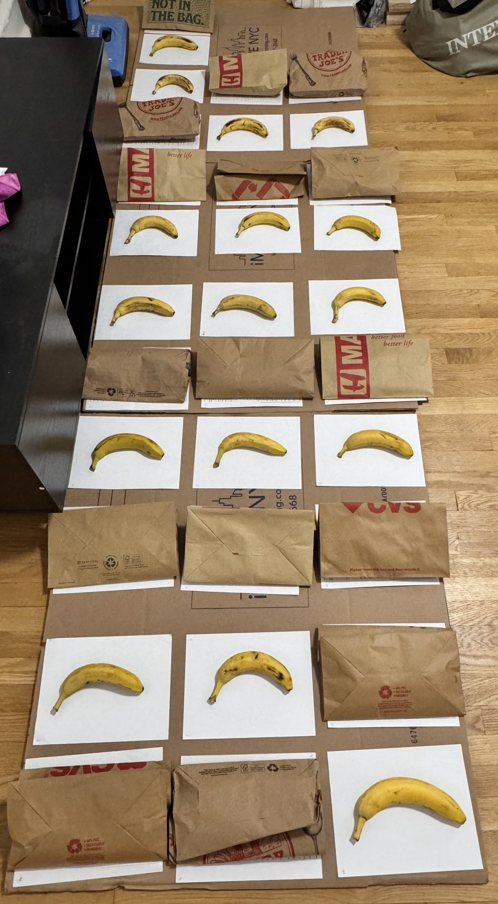
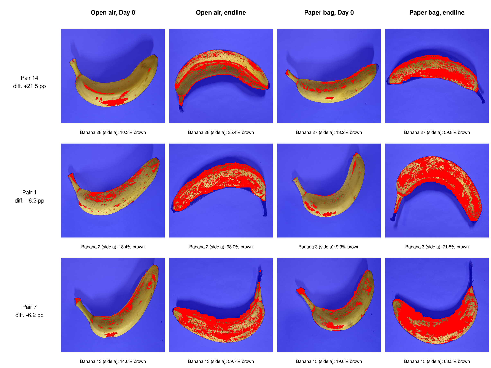
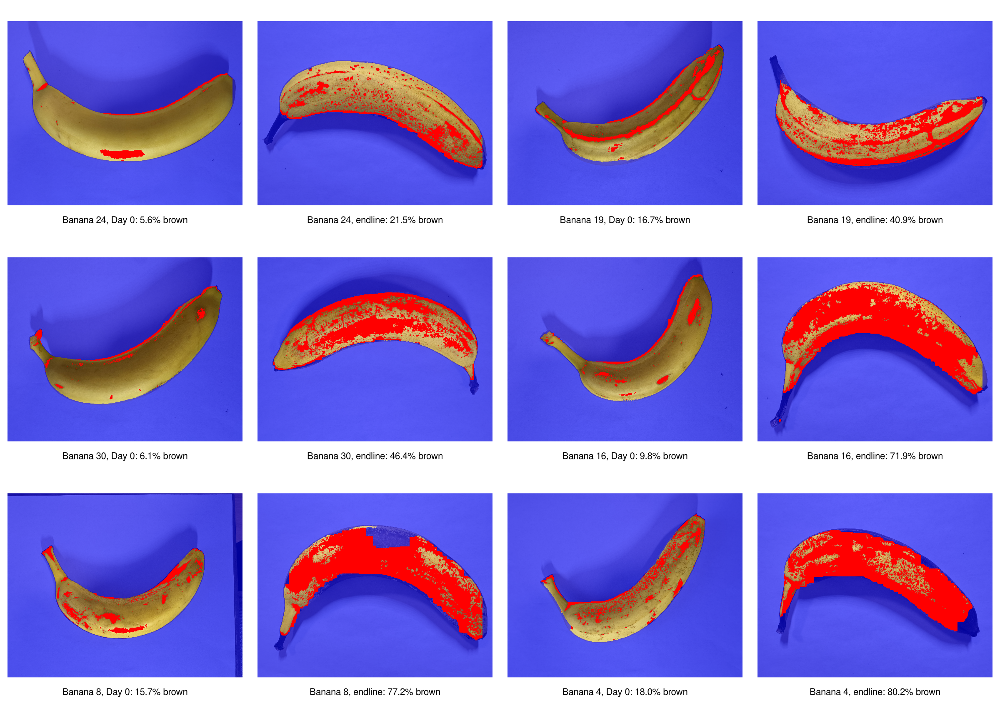
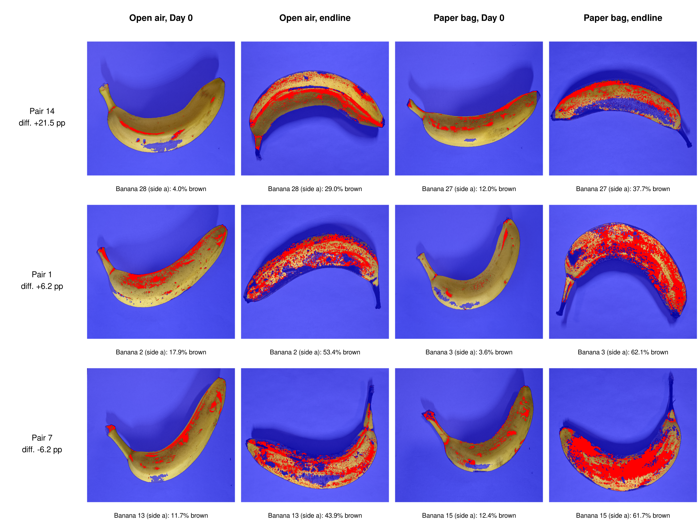
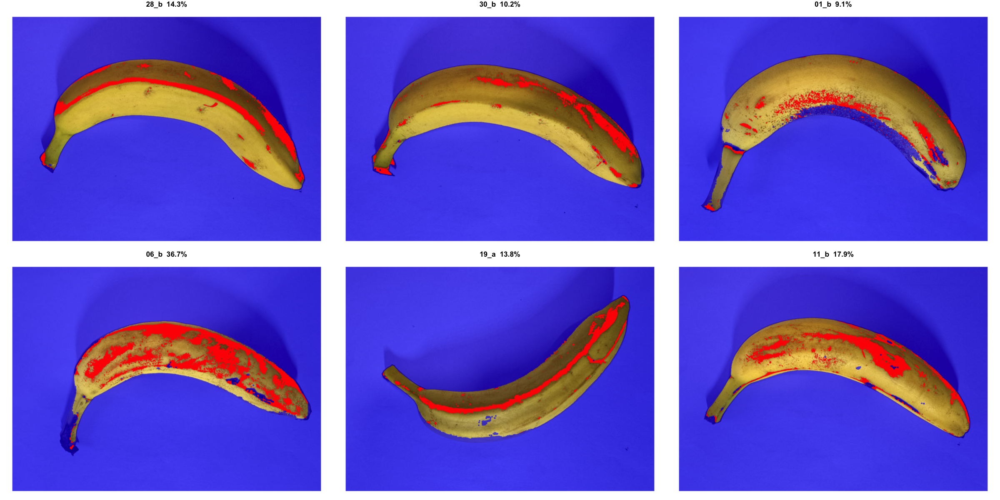

```{r setup, include=FALSE}
knitr::opts_chunk$set(echo = FALSE, message = FALSE, warning = FALSE,
                      fig.align = "center", fig.width = 6, fig.height = 3.6, fig.pos = "H")
library(randomizr)
library(ri2)
library(estimatr)
library(dplyr)
library(broom)
library(ggplot2)
library(knitr)

rm(list = ls())

theme_set(theme_bw(base_size = 10))
fmt   <- function(x, k = 1) formatC(x, format = "f", digits = k)
fmt_p <- function(p) if (p < 0.001) "< 0.001" else paste("=", formatC(p, format = "f", digits = 3))
p_str <- function(p) sub("^= ", "", fmt_p(p))
```

```{r data}
# Assignment (R/02_randomize.R); brown0_v1 is the Day-0 value from the registered script
a <- read.csv("data/assignment.csv")

# Percent brown from the two pixel masks, Day 0 and endline (the last photographed day)
reg <- read.csv("data/brown_from_photos_v1.csv")   # registered peel mask, R/03_measure_photos.R
alt <- read.csv("data/brown_alt_fruitmask.csv")    # revised measure (fruit outline), R/06_alt_measure.R
ENDLINE <- max(reg$day)
pick <- function(x, day, col, name) setNames(x[x$day == day, c("id", col)], c("id", name))
d <- a %>%
  merge(pick(reg, ENDLINE, "brown_pct", "Y"),         by = "id") %>%   # pre-registered measure
  merge(pick(reg, 0,       "brown_pct", "Y0"),        by = "id") %>%
  merge(pick(alt, ENDLINE, "brown_alt", "Y_rev"),     by = "id") %>%   # revised measure (fruit outline)
  merge(pick(alt, 0,       "brown_alt", "Y0_rev"),    by = "id")

d$condition <- factor(ifelse(d$Z == 1, "Paper bag", "Open air"), levels = c("Open air", "Paper bag"))
d$Y0_c      <- d$Y0 - mean(d$Y0)
d$Y0_rev_c  <- d$Y0_rev - mean(d$Y0_rev)
d <- d[order(d$pair, d$Z), ]

# Measurement checks on the Day-0 photos: registered script vs. the researcher's 1-5 eye ratings
eye <- read.csv("data/eye_vs_photo_day0.csv")
rho_photo  <- cor(eye$eye_rating, eye$brown_pct, method = "spearman")
eye_banana <- aggregate(cbind(eye_rating, brown_pct) ~ id, eye, mean)
rho_banana <- cor(eye_banana$eye_rating, eye_banana$brown_pct, method = "spearman")
r_masks_0   <- cor(d$Y0, d$Y0_rev)      # agreement of the two masks on Day 0
r_masks_end <- cor(d$Y,  d$Y_rev)       # and at endline
```

```{r estimation}
decl <- declare_ra(blocks = d$pair)
perm <- obtain_permutation_matrix(decl, maximum_permutations = 70000)   # all 2^16 = 65,536 assignments

# Difference in means within pairs (FEDAI eq. 3.10), RI p-value, RI confidence interval.
# The CI imputes potential outcomes under a constant effect equal to the estimate (FEDAI ch. 3).
ri_fit <- function(f) {
  est <- difference_in_means(f, blocks = pair, data = d)
  ate <- unname(coef(est)[1])
  ri0 <- conduct_ri(f, declaration = decl, assignment = "Z", sharp_hypothesis = 0,
                    data = d, permutation_matrix = perm)
  ri1 <- conduct_ri(f, declaration = decl, assignment = "Z", sharp_hypothesis = ate,
                    data = d, permutation_matrix = perm)
  list(ate = ate, se = est$std.error, ri = ri0, p = summary(ri0)$two_tailed_p_value,
       ci = unname(quantile(ri1$sims_df$est_sim, c(0.025, 0.975))))
}
# Covariate adjustment: pair fixed effects + centered Day-0 percent brown on the same mask
adj_fit <- function(f) {
  est <- lm_robust(f, fixed_effects = ~ pair, data = d)
  ri  <- conduct_ri(update(f, . ~ . + factor(pair)), declaration = decl, assignment = "Z",
                    sharp_hypothesis = 0, data = d, permutation_matrix = perm)
  list(ate = unname(coef(est)["Z"]), se = est$std.error["Z"],
       ci = c(est$conf.low["Z"], est$conf.high["Z"]), p = summary(ri)$two_tailed_p_value)
}

prim    <- ri_fit(Y ~ Z)                  # pre-registered measure (confirmatory)
prim_a  <- adj_fit(Y ~ Z + Y0_c)
revm    <- ri_fit(Y_rev ~ Z)              # revised measure
revm_a  <- adj_fit(Y_rev ~ Z + Y0_rev_c)

# Balance: Day-0 percent brown by assignment
bal <- ri_fit(Y0 ~ Z)

# Descriptives
m0 <- mean(d$Y[d$Z == 0]);     m1 <- mean(d$Y[d$Z == 1])
v0 <- mean(d$Y_rev[d$Z == 0]); v1 <- mean(d$Y_rev[d$Z == 1])
tr <- d[d$Z == 1, ]; co <- d[d$Z == 0, ]
tr <- tr[order(tr$pair), ]; co <- co[order(co$pair), ]
dpair     <- tr$Y - co$Y
dpair_rev <- tr$Y_rev - co$Y_rev
n_pos     <- sum(dpair > 0)
n_pos_rev <- sum(dpair_rev > 0)
r_pre     <- cor(d$Y0, d$Y)
```

\begin{center}
\small Pre-analysis plan: \url{https://osf.io/ev87w/} \quad Data, photos and code: \url{https://github.com/Jingtian-Hu/prac}
\end{center}

**Summary.** I randomly assigned one banana in each of 16 matched pairs to sit sealed in a kraft paper bag for three days while its partner lay uncovered beside it. The outcome is the share of peel area that was brown at the end of that period, measured from photographs by a pixel-classification script fixed before assignment. On that pre-registered measure, bagged bananas ended with `r fmt(prim$ate)` percentage points more brown peel than their partners (SE `r fmt(prim$se)`, 95% CI [`r fmt(prim$ci[1])`, `r fmt(prim$ci[2])`], randomization-inference p `r fmt_p(prim$p)`). The registered script drops peel that has turned fully brown, so I also report a measure revised after the endline photographs were processed, which outlines the whole fruit; it gives `r fmt(revm$ate)` points (SE `r fmt(revm$se)`, p `r fmt_p(revm$p)`).

## 1. Motivation and Hypothesis

Bananas are climacteric fruit: after harvest they keep ripening, and the process is driven by ethylene, a gas the fruit produces itself and responds to. As a banana ripens, starch turns to sugar, the green peel turns yellow, and brown "sugar spots" appear as peel cells age and their phenolic compounds oxidize. Because ethylene speeds up its own production, ripening fruit kept in a small enclosed space tends to ripen faster. This is the basis of a common kitchen tip: put bananas in a paper bag to ripen them. Paper is the usual recommendation because it holds some ethylene near the fruit while letting moisture escape, whereas plastic traps moisture and invites rot. 

**Hypothesis.** A banana sealed alone in a kraft paper bag will show a larger share of brown peel at the end of the experiment than an uncovered banana kept in the same room. The pre-analysis plan states the hypothesis directionally and tests it two-sided at the 5% level. The estimand is the average treatment effect over the 32 bananas, $\frac{1}{32}\sum_i [Y_i(1) - Y_i(0)]$, where $Y_i(1)$ and $Y_i(0)$ are banana $i$'s percent brown peel at endline if bagged and if uncovered.

## 2. Design

**Subjects.** The subjects are 32 bananas bought at one store in six hands: three conventional hands (18 bananas) and three organic hands (14). The hands were cut apart at the crown, so each banana is a separate unit, and each was labeled with a number from 1 to 32.

**Blocking and random assignment.** Bananas from the same hand share their growing and shipping history, and the hands differed visibly in ripeness, so I blocked on hand and on baseline browning. Every banana was photographed before assignment, and its Day-0 percent brown was measured with the registered script (Section 3). Within each hand, bananas were sorted by Day-0 percent brown and adjacent bananas were paired. The four hands with an odd number of bananas each left one over; these four were paired with each other within organic status. This produced 16 pairs, nine conventional and seven organic. In each pair, `randomizr::block_ra()` assigned one banana to the bag with probability 1/2 (seed 20261104). The code was run after the plan was registered on OSF, with no manual input. Appendix A1 shows the baseline values by pair.

**Treatment and setting.** Each treated banana was sealed alone in a kraft paper bag with the top folded over. Control bananas lay uncovered. All 32 bananas were kept on the floor of one ventilated room with no other fruit, each on its own sheet of white paper. The two bananas of a pair sat side by side in one of 16 slots, and slots and left/right positions were randomized, so light, drafts and temperature differ between pairs but hardly within them (Figure 1). Bagging took place right after the Day-0 photographs and the random assignment. The endpoint fixed in the pre-analysis plan is Day 3, 72 hours after bagging; the endline photographs were taken then, and no banana was handled in between.

```{r fig-setup, out.width="45%", fig.cap="The experiment after bagging. Each slot holds one pair side by side; bagged bananas are inside the folded paper bags."}

```

**Outcome.** The outcome is the percent of peel area that is brown at endline, averaged over the two photographed sides of the banana. Section 3 describes how it is measured and why two versions of it are reported.

## 3. Measurement

**Protocol.** Each banana was photographed on both sides against white paper, with the phone at a fixed height under the same lamp, once before assignment (Day 0) and once at endline. Files are named by banana number and side only, no label appears in the frame, and one script processes every photo, so bagged and uncovered bananas are measured in exactly the same way and the measurement cannot depend on assignment.

**Pre-registered measure.** The registered script, `R/03_measure_photos.R`, works in the hue-saturation-brightness color space. It first finds the peel, defined as saturated yellow-to-orange pixels plus the very dark spots next to them. It then compares each peel pixel with the brightest clean peel within about one centimeter. A lamp lights one side of a banana more than the other, so a single brightness cutoff would call shaded yellow peel brown; the local comparison removes most of that shading. A peel pixel counts as brown if it is less than 75% as bright as this local reference and not yellow in hue, or if it is reddish-brown or very dark. Percent brown is brown peel pixels over all peel pixels. All thresholds were tuned on the 64 Day-0 photos and frozen in the registered commit. As a check, I rated every Day-0 photo by eye on a 1-5 scale; the Spearman correlation with the script is `r fmt(rho_photo, 2)` across photos and `r fmt(rho_banana, 2)` across bananas (Appendix A3).

**What the endline photos showed.** The registered peel test is, in effect, a yellowness test. It was tuned on Day-0 photos, where nearly all of the peel is yellow and the test covers the fruit. At endline, large areas of peel on the brownest bananas had turned a dull, unsaturated brown that fails the test. Those areas are left out of the measure entirely, so what it reports is the brown share of the peel that is still yellow enough to be recognized as peel, and the shortfall is largest on the bananas that browned most. Appendix A2 shows these areas in blue.

**Revised measure.** After the endline photos were processed, I added a second script, `R/06_alt_measure.R`, that replaces the peel test with a fruit outline. The outline starts from the registered peel, adds the dark brown pixels that touch it, and is closed so that brown patches surrounded by peel are included; cast shadows on the paper are lighter than brown peel and lie outside the outline. The outline also takes in the dark stem and tip ends, which the registered test drops and which are not peel in the strict sense; they add about the same small amount to every banana. Within the outline, a pixel counts as brown unless the registered rule classifies it as clean yellow peel. This changes both parts of the ratio: pixels the registered rule accepted as peel keep their classification, while the dull brown areas and the stem ends, which the registered rule did not accept as peel at all, now enter the numerator and the denominator together. For banana $i$ and either measure,

$$
Y_i = \frac{1}{2} \sum_{s \in \{a,\, b\}} 100 \times \frac{\text{brown pixels in photo } (i, s)}{\text{peel (or fruit) pixels in photo } (i, s)} .
$$

The pre-registered measure is the confirmatory outcome and is reported first throughout. The revised measure was defined after the outcome data existed, so I report it as a post hoc robustness check, with the same estimator and test. On Day 0 the two measures rank the bananas almost identically (correlation `r fmt(r_masks_0, 2)`), with the revised one `r fmt(mean(d$Y0_rev) - mean(d$Y0))` points higher (means `r fmt(mean(d$Y0_rev))`% and `r fmt(mean(d$Y0))`%) mainly because of the stem ends. At endline the revised measure reads `r fmt(mean(d$Y_rev) - mean(d$Y))` points higher on average and the correlation is `r fmt(r_masks_end, 2)`. Figure 2 shows the revised measure on three pairs.

```{r fig-before-after, out.width="100%", fig.cap="Day-0 and endline photos of three pairs with the revised fruit outline painted on: red = brown, blue = outside the outline. The pairs are the one with the largest bagged-minus-open difference on this measure, the one closest to the average difference, and the one with the most negative difference. Appendix A2 shows the same photos under the registered peel test."}

```

## 4. Core Assumptions

**Random assignment.** Assignment was generated by code within each pair with known probability 1/2. Table 1 compares the arms. The Day-0 difference in percent brown is `r fmt(bal$ate)` percentage points (randomization-inference p = `r fmt(bal$p, 3)`), so the arms were similar before treatment.

```{r tab-descriptive}
desc <- d %>% group_by(condition) %>%
  summarise(n = n(), organic = sum(organic),
            y0 = sprintf("%s (%s)", fmt(mean(Y0)), fmt(sd(Y0))),
            y  = sprintf("%s (%s)", fmt(mean(Y)), fmt(sd(Y))),
            v0 = sprintf("%s (%s)", fmt(mean(Y0_rev)), fmt(sd(Y0_rev))),
            v  = sprintf("%s (%s)", fmt(mean(Y_rev)), fmt(sd(Y_rev))), .groups = "drop")
kable(desc, booktabs = TRUE, align = "lrrrrrr",
      col.names = c("Condition", "Bananas", "Organic", "Day 0", "Endline", "Day 0", "Endline"),
      caption = paste("Bananas by condition. Percent brown peel, mean (SD): columns 4-5 use the",
                      "pre-registered measure, columns 6-7 the revised measure."))
```

**Non-interference.** Each banana's outcome should depend only on its own bag. Ethylene from a bagged banana could leak through the paper and reach its uncovered partner a few centimeters away. Such spillover would raise the control outcomes and push the estimate toward zero.

**Excludability.** A paper bag changes the ethylene concentration, the humidity and the light around the banana at the same time. The estimate is therefore the effect of the bag as a whole, not of ethylene alone. Measurement is identical across arms and blind to assignment, so it cannot create a difference between them. The revised measure was defined after the outcome photos existed, which is why it is reported as a robustness check rather than as the confirmatory result.

**Compliance and attrition.** Every assigned banana received its condition and stayed in it, and all 32 were photographed at endline. There is no noncompliance and no attrition, so the intention-to-treat estimate is the average treatment effect.

## 5. Results

Figure 3 shows the endline outcomes. Both groups browned a great deal, and both are spread out: the three conventional hands, which were also riper on Day 0, ended around 55-65% brown on average, and the three organic hands around 20-30%. Pairing within hand keeps this spread out of the treatment-control comparison; Day-0 and endline browning are correlated at `r fmt(r_pre, 2)`.

```{r fig-distribution, fig.height=3.4, fig.cap="Distribution of endline percent brown peel (pre-registered measure) by condition, 16 bananas per condition."}
ggplot(d, aes(Y)) +
  geom_histogram(binwidth = 5, boundary = 0, fill = "grey70", colour = "black") +
  facet_wrap(~ condition, ncol = 1) +
  labs(x = "Percent brown peel area at endline", y = "Frequency")
```


Table 2 gives the results. On the pre-registered measure, bagged bananas ended at `r fmt(m1)`% brown and uncovered bananas at `r fmt(m0)`%. The within-pair estimate of the average treatment effect is `r fmt(prim$ate)` percentage points with a standard error of `r fmt(prim$se)`, and the bagged banana was the browner one in `r n_pos` of the 16 pairs (Figure 4 and Appendix A4). Adjusting for Day-0 browning gives `r fmt(prim_a$ate)` points.

```{r tab-results}
row <- function(lab, r) {
  data.frame(Estimate = lab, ATE = fmt(r$ate, 2), SE = fmt(r$se, 2),
             CI = sprintf("[%s, %s]", fmt(r$ci[1]), fmt(r$ci[2])), p = p_str(r$p))
}
tab <- rbind(
  row("Pre-registered measure: difference in means", prim),
  row("Pre-registered measure: adjusted for Day-0 browning", prim_a),
  row("Revised measure (post hoc): difference in means", revm),
  row("Revised measure (post hoc): adjusted for Day-0 browning", revm_a))
rownames(tab) <- NULL
kable(tab, booktabs = TRUE, row.names = FALSE, align = "lrrrr",
      col.names = c("Outcome and estimator", "ATE (pp)", "SE", "95\\% CI", "RI $p$"),
      escape = FALSE,
      caption = paste("Effect of a paper bag on percent brown peel at endline (16 pairs).",
                      "Differences in means are within pairs, with CIs from randomization",
                      "inference under a constant effect. Adjusted estimates use pair fixed",
                      "effects and the Day-0 value of the same measure, with CIs from the",
                      "robust standard error. All p-values come from randomization inference",
                      "over the 65,536 possible assignments; $p$-values are two-sided."))
```

To test the sharp null hypothesis that the bag had no effect on any banana, I compared the observed estimate with the estimates from all 65,536 assignments the design could have produced (Figure 5). Only `r fmt(100 * prim$p, 1)`% of them are as far from zero as the observed one (two-sided p `r fmt_p(prim$p)`), so the sharp null is rejected at the 5% level. The 95% confidence interval, built by assuming a constant effect equal to the estimate, is [`r fmt(prim$ci[1])`, `r fmt(prim$ci[2])`]: the effect could be anywhere from barely visible to about `r fmt(prim$ci[2], 0)` points.

On the revised measure, bagged bananas ended at `r fmt(v1)`% brown and uncovered bananas at `r fmt(v0)`%, a difference of `r fmt(revm$ate)` points (SE `r fmt(revm$se)`, 95% CI [`r fmt(revm$ci[1])`, `r fmt(revm$ci[2])`], RI p `r fmt_p(revm$p)`), with the bagged banana browner in `r n_pos_rev` of the 16 pairs. The two measures agree on the direction of the effect and on rejecting the sharp null; they differ in size by about `r fmt(revm$ate - prim$ate)` points. That gap is consistent with the way the registered measure fails, since it leaves out brown peel mainly on the brownest bananas, but without an independent endline standard it cannot be read as a measured bias; what the comparison shows is how sensitive the estimate is to the choice of mask. Appendix A5 reports both measures by subgroup.

```{r fig-coppock, fig.height=3.8, fig.cap="Endline percent brown peel (pre-registered measure) by condition. Small points are bananas, and grey lines join the two bananas of a pair. Large points are condition means with 95\\% confidence intervals."}
summ <- d %>%
  group_by(condition) %>%
  do(tidy(lm_robust(Y ~ 1, data = .))) %>%
  mutate(Y = estimate)
set.seed(343)
d$xj <- as.numeric(d$condition) + runif(nrow(d), -0.15, 0.15)
ggplot(summ, aes(as.numeric(condition), Y)) +
  geom_line(data = d, aes(xj, Y, group = pair), colour = "grey85") +
  geom_point(data = d, aes(xj, Y), alpha = 0.3) +
  geom_point(size = 3) +
  geom_errorbar(aes(ymin = conf.low, ymax = conf.high), width = 0) +
  scale_x_continuous(breaks = 1:2, labels = levels(d$condition)) +
  ylab("Percent brown peel area at endline") +
  theme(axis.title.x = element_blank())
```

```{r fig-ri, fig.height=3.2, fig.cap="Randomization distribution of the estimated ATE (pre-registered measure) under the sharp null of no effect, over all 65,536 possible assignments. The vertical line is the observed estimate; shaded bars are at least as extreme."}
p_ri <- plot(prim$ri)
p_ri$layers[[1]] <- geom_histogram(bins = 60)   # ri2 defaults to sims/20 bins
p_ri + ggtitle(NULL) + theme_bw(base_size = 10) + theme(legend.position = "bottom")
```

## 6. Conclusion

Under the conditions of this experiment, sealing a single banana in a kraft paper bag for three days increased the share of its peel that was brown at the end of that period. On the pre-registered measure, the effect is about `r fmt(prim$ate, 0)` percentage points of peel area, and the sharp null of no effect is rejected at the 5% level. The revised measure, which also counts peel that the registered script drops, gives about `r fmt(revm$ate, 0)` points.

These results are broadly consistent with the traditional tip: a paper bag does speed up browning. The effect is modest, however, next to the browning that occurred in both arms, where uncovered bananas reached `r fmt(m0, 0)`% brown on the pre-registered measure. One likely reason is that the tip is usually given for a whole bunch. A single banana produces less ethylene, so the bag has less to trap and its effect may be less visible than it would be for a bunch.

## References

Coppock, A. 2021. "Visualize as You Randomize: Design-Based Statistical Graphs for Randomized Experiments." In J. N. Druckman and D. P. Green (eds.), *Advances in Experimental Political Science*. Cambridge University Press.

Gerber, A. S., and D. P. Green. 2012. *Field Experiments: Design, Analysis, and Interpretation*. New York: W. W. Norton.


## Appendix

### A1. Baseline browning by pair

```{r fig-design, fig.width=7, fig.height=3.4, fig.cap="Day-0 percent brown (pre-registered measure, used for pairing) for both bananas of each pair, by hand and assigned condition."}
lab <- d %>% group_by(pair) %>%
  summarise(group = if (n_distinct(bunch) > 1) "Cross-hand" else paste("Hand", first(bunch)),
            .groups = "drop")
dd <- merge(d, lab, by = "pair")
ggplot(dd, aes(factor(pair), Y0, shape = condition)) +
  geom_line(aes(group = pair), colour = "grey60") +
  geom_point(size = 2.5, fill = "white") +
  scale_shape_manual(values = c(16, 21)) +
  facet_grid(~ group, scales = "free_x", space = "free_x") +
  labs(x = "Pair", y = "Day-0 percent brown", shape = NULL) +
  theme(legend.position = "bottom", strip.text = element_text(size = 8))
```

### A2. More measurement examples

```{r fig-fruit-sheet, out.width="100%", fig.cap="The revised fruit outline on six bananas spanning the range of endline browning (side a, Day 0 and endline; red = brown, blue = outside the outline)."}

```


```{r fig-before-after-reg, out.width="100%", fig.cap="The photos of Figure 2 under the pre-registered peel test (red = brown, blue = not counted as peel). At endline, much of the dull brown peel fails the peel test and is blue."}

```

```{r fig-overlay, out.width="100%", fig.cap="The pre-registered peel test on six Day-0 photos (red = brown, blue = not peel). Titles give banana, side and percent brown."}

```

### A3. Algorithm versus eye ratings

```{r fig-eye, fig.height=3.2, fig.cap="Registered-script percent brown against the researcher's 1-5 eye rating for the 64 Day-0 photos."}
ggplot(eye, aes(eye_rating, brown_pct)) +
  geom_jitter(width = 0.06, height = 0, alpha = 0.6,
              aes(shape = factor(organic, labels = c("Conventional", "Organic")))) +
  geom_smooth(method = "lm", se = FALSE, colour = "black", linewidth = 0.5) +
  scale_shape_manual(values = c(16, 1)) +
  labs(x = "Eye rating (1 = almost no spots, 5 = large brown areas)",
       y = "Percent brown (registered script)", shape = NULL) +
  theme(legend.position = "bottom")
```

### A4. Within-pair differences and change from Day 0

```{r fig-pairs, fig.height=3.6, fig.width=7, fig.cap="Bagged minus open-air endline percent brown in each pair, on the pre-registered and the revised measure. Solid lines are the estimated ATEs and shaded bands their 95\\% confidence intervals."}
pd <- rbind(data.frame(measure = "Pre-registered measure", pair = tr$pair, diff = dpair),
            data.frame(measure = "Revised measure", pair = tr$pair, diff = dpair_rev))
pd$pair <- factor(pd$pair, levels = tr$pair[order(dpair)])
bands <- data.frame(measure = c("Pre-registered measure", "Revised measure"),
                    ate = c(prim$ate, revm$ate), lo = c(prim$ci[1], revm$ci[1]), hi = c(prim$ci[2], revm$ci[2]))
ggplot(pd, aes(diff, pair)) +
  geom_vline(xintercept = 0, linetype = "dotted") +
  geom_rect(data = bands, aes(xmin = lo, xmax = hi, ymin = -Inf, ymax = Inf), inherit.aes = FALSE, alpha = 0.15) +
  geom_vline(data = bands, aes(xintercept = ate)) +
  geom_point(size = 2) +
  facet_wrap(~ measure) +
  labs(x = "Bagged minus open-air banana, percent brown at endline", y = "Pair")
```

```{r fig-day0-endline, fig.width=5, fig.height=3.4, fig.cap="Mean percent brown (pre-registered measure) by condition at Day 0 (before assignment) and at endline, with 95\\% confidence intervals."}
long <- rbind(data.frame(day = "Day 0", condition = d$condition, Y = d$Y0),
              data.frame(day = "Endline", condition = d$condition, Y = d$Y))
s5 <- long %>% group_by(day, condition) %>%
  summarise(m = mean(Y), s = sd(Y) / sqrt(n()), .groups = "drop")
dodge <- position_dodge(width = 0.2)
ggplot(s5, aes(day, m, group = condition, shape = condition, linetype = condition)) +
  geom_line(position = dodge) +
  geom_errorbar(aes(ymin = m - 1.96 * s, ymax = m + 1.96 * s), width = 0,
                linetype = "solid", position = dodge) +
  geom_point(size = 3, position = dodge, fill = "white") +
  scale_shape_manual(values = c(16, 21)) +
  labs(x = NULL, y = "Percent brown peel area", shape = NULL, linetype = NULL) +
  theme(legend.position = "bottom")
```

### A5. Effects by subgroup (exploratory)

The plan lists effects by organic status and by baseline browning as descriptive, exploratory comparisons. Table 3 reports them for both measures. With seven to nine pairs per group the subgroup estimates are imprecise, and no conclusion rests on them.

```{r tab-subgroup}
pairs <- data.frame(pair = tr$pair, organic = tr$organic, d = dpair, d_rev = dpair_rev,
                    ripe = (tr$Y0 + co$Y0) / 2 > median((tr$Y0 + co$Y0) / 2))
sub <- function(lab, sel) {
  x <- pairs$d[sel]; v <- pairs$d_rev[sel]
  data.frame(Group = lab, Pairs = length(x), ATE = fmt(mean(x), 2), SE = fmt(sd(x) / sqrt(length(x)), 2),
             ATE_rev = fmt(mean(v), 2), SE_rev = fmt(sd(v) / sqrt(length(v)), 2))
}
subt <- rbind(sub("Conventional pairs", pairs$organic == 0),
              sub("Organic pairs", pairs$organic == 1),
              sub("Pairs below median Day-0 browning", !pairs$ripe),
              sub("Pairs above median Day-0 browning", pairs$ripe))
kable(subt, booktabs = TRUE, row.names = FALSE, align = "lrrrrr",
      col.names = c("Group", "Pairs", "ATE (pp)", "SE", "ATE (pp)", "SE"),
      caption = paste("Within-pair differences in endline percent brown by subgroup: columns 3-4",
                      "pre-registered measure, columns 5-6 revised measure."))
```

### A6. Data

```{r data-table}
cols <- c("id", "bunch", "organic", "pair", "Z", "Y0", "Y", "Y0_rev", "Y_rev")
kable(d[order(d$id), cols], digits = 1, row.names = FALSE, booktabs = TRUE,
      col.names = c("ID", "Hand", "Organic", "Pair", "Bagged", "Day 0", "Endline",
                    "Day 0, rev.", "Endline, rev."),
      caption = paste("Banana-level data: percent brown peel on the pre-registered measure and on",
                      "the revised measure (rev.), averaged over the two photographed sides."))
```

### A7. R code

```{r ref.label=knitr::all_labels(), echo=TRUE, eval=FALSE}
```
